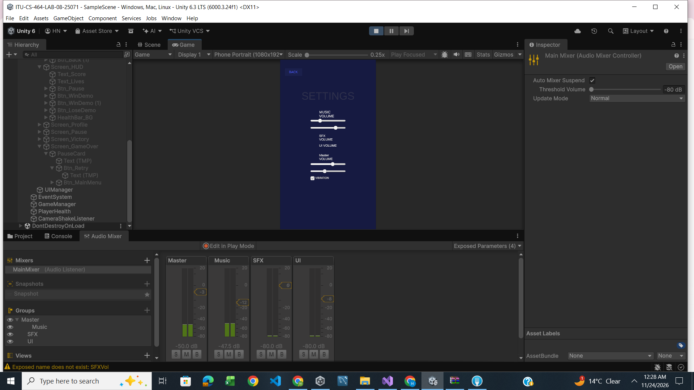
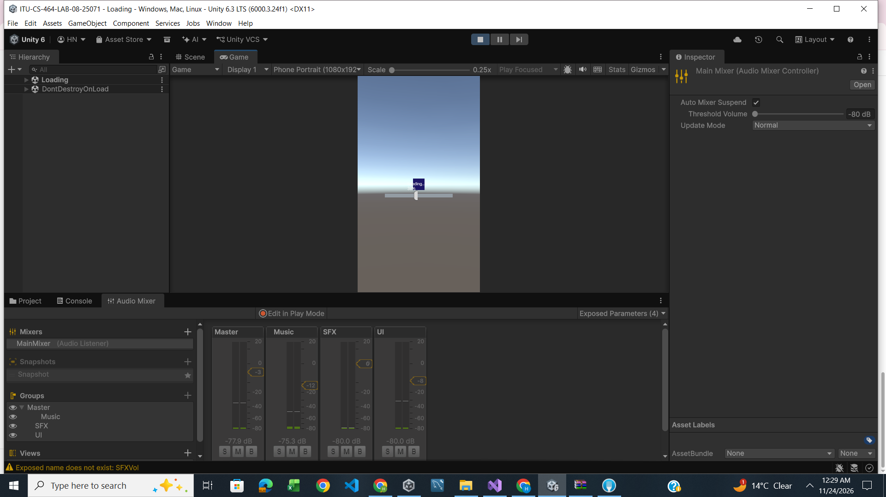
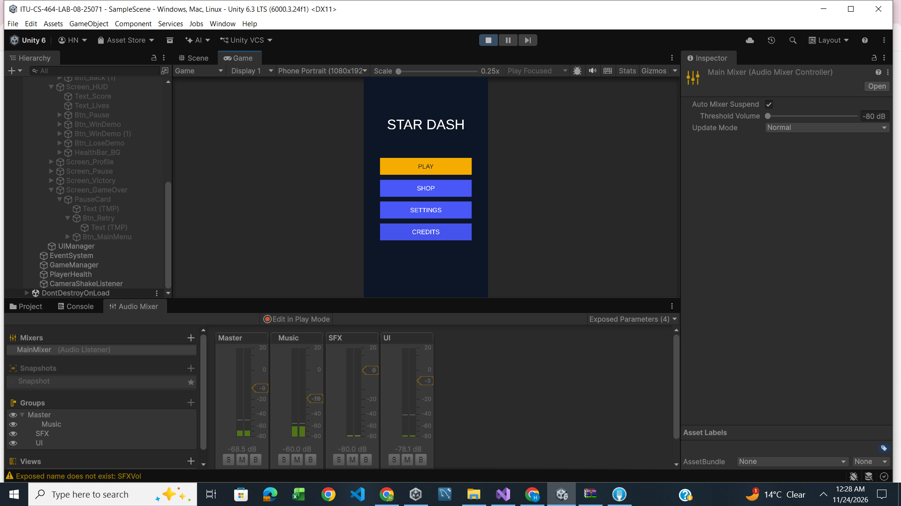
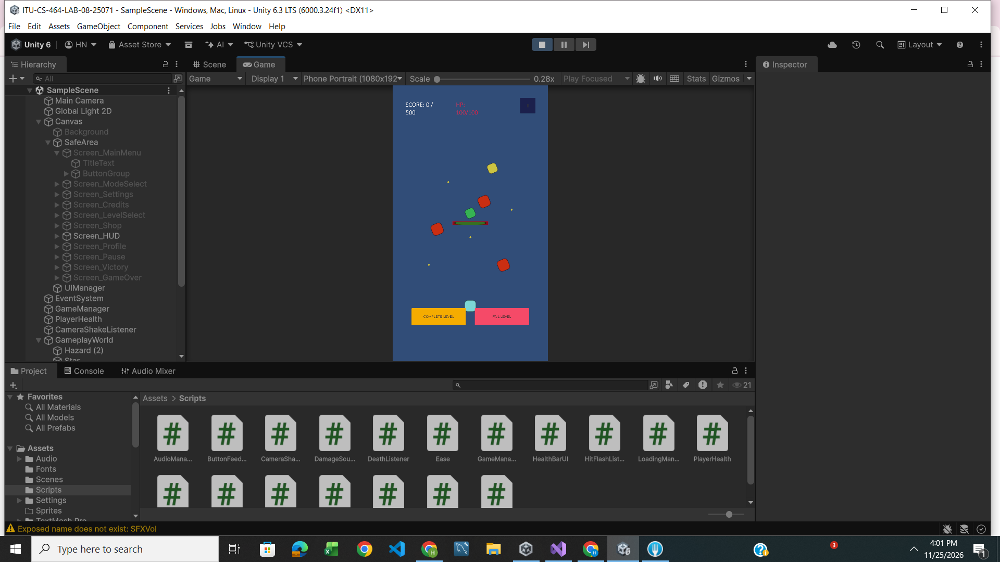
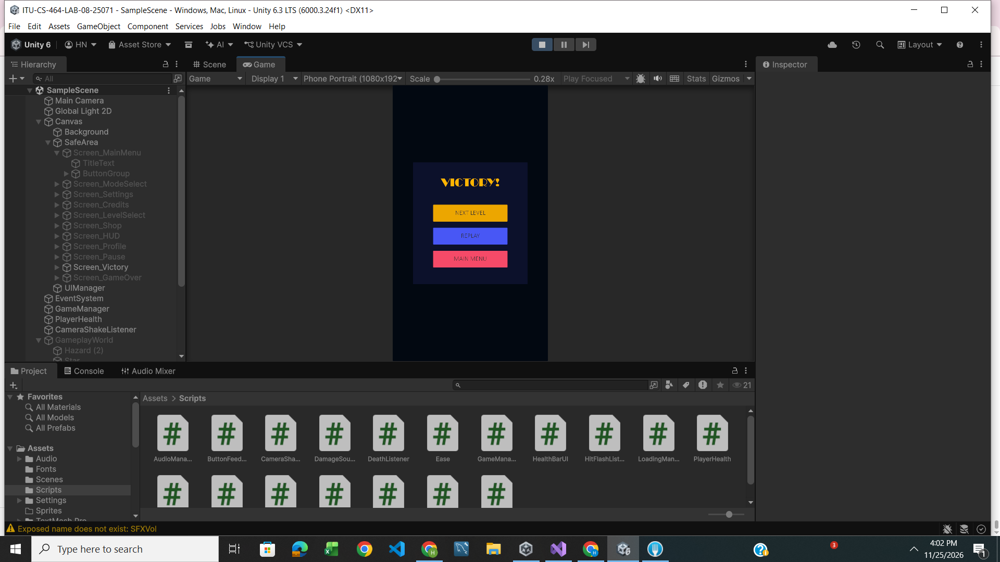
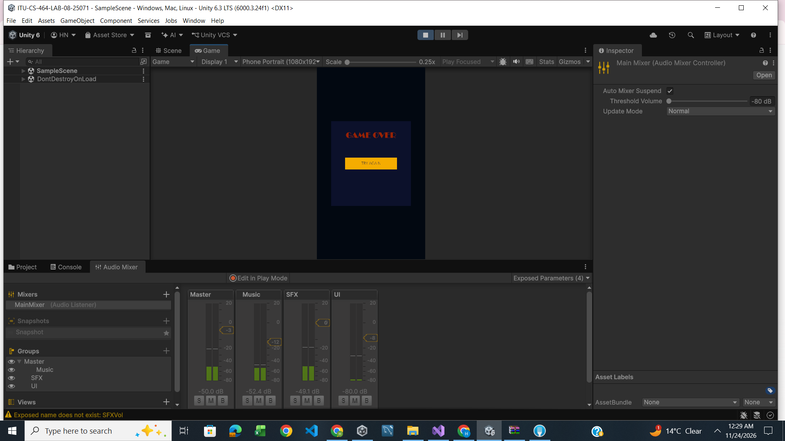

# Star Dash — Lab 08
**Roll Number:** BSCS25071  
**Course:** CS-464 Game Development (Lab 08)  
**Unity Version:** Unity 6 (6000.3.24f1)  

## Demo Video
You can watch the complete walkthrough of the playable Star Dash gameplay, audio system, loading screen, and event system here:  
https://drive.google.com/file/d/1UWhafybizXAHRIu480drES89l7Sgig1Q/view?usp=sharing

---

## Project Overview
This project is an extension of our **Star Dash** game from Lab 07, developed using Unity. In this lab, we implemented a complete playable 2D level along with an `AudioMixer`-based audio system, persistent volume controls, an asynchronous loading screen, and a decoupled C# event architecture.
## Features Implemented

### 1. Playable Star Dash Gameplay (`StarDashPlayer` & `StarDashItem`)
- **Controls:** Move the player ship across the arena using **WASD** or **Arrow Keys**.
- **Collectibles & Scoring:**
  - **Stars (`+100` pts):** Collecting falling stars updates the HUD score (`ScoreChanged` event) and triggers pickup audio.
  - **Energy Boosts (`+250` pts):** Collecting boosts grants bonus points and plays the boost sound effect.
- **Hazards (`-25` HP):** Colliding with red hazards reduces health via `PlayerHealth.TakeDamage25()`, triggering damage audio, screen flash, and camera shake.
- **Win / Lose & Replay Flow:** Reaching the target score (`500` pts) fires the `Won` event to open the **Victory** screen, while reaching `0` HP fires the `Died` event to open the **Game Over** screen. Restarting or re-entering gameplay automatically resets player health, score, and game state.

### 2. Audio System
- Created an `AudioMixer` with four separate groups: **Master**, **Music**, **SFX**, and **UI**.
- Implemented a singleton `AudioManager` to manage background music transitions across menu, gameplay, and result states.
- Converted linear slider values (`0.0001` to `1`) to logarithmic decibels (`Mathf.Log10(value) * 20f`) and persisted volume settings via `PlayerPrefs`.

### 3. UI & Gameplay Audio
- **UI Audio:** Added click, panel open/close, navigation, pause, and resume sounds routed through the **UI** mixer group.
- **Gameplay Audio:** Added distinct sound effects for star pickup, boost, hazard damage, victory, and game over routed through the **SFX** mixer group.

### 4. Asynchronous Loading Screen
- Built a `Loading` scene using `SceneManager.LoadSceneAsync()` with a smooth progress bar, percentage counter, and gameplay tips before entering gameplay.

### 5. Decoupled C# Events
- Implemented C# `Action` events (`Damaged`, `Healed`, `ScoreChanged`, `Died`, `Won`) in `PlayerHealth`.
- Subscribed independent listeners (`HealthBarUI`, `DamageSoundListener`, `HitFlashListener`, `CameraShakeListener`, `DeathListener`, and `StarDashPlayer`) so gameplay, UI, and audio stay cleanly separated.

---

## Screenshots

### Audio Settings
| Settings Screen (Volume Sliders) | Audio Mixer Live (Master / Music / SFX / UI) |
| :---: | :---: |
|  |  |

- Settings screen includes Master, Music, SFX, and UI volume sliders plus a Vibration toggle saved via `PlayerPrefs`.
- The Audio Mixer window displays live signal levels across all four groups at runtime.

### Loading Screen

- Asynchronous scene loading with a progress bar and percentage readout.

### Main Menu

- Star Dash Main Menu with UI audio feedback and background music routed through the mixer.

### Live Gameplay

- Playable level: the HUD shows the `SCORE` (target 500) and `HP` while stars, boosts and red hazards fall into the arena.
- Collecting items updates the score through the `ScoreChanged` event, and hazards trigger the `Damaged` event (damage sound, screen flash, camera shake).

### Result Screens
| Victory (Won event) | Game Over (Died event) |
| :---: | :---: |
|  |  |

- Reaching `500` score fires the `Won` event and opens the Victory screen (Next Level, Replay, Main Menu).
- Reaching `0` HP fires the `Died` event and opens the Game Over screen.

