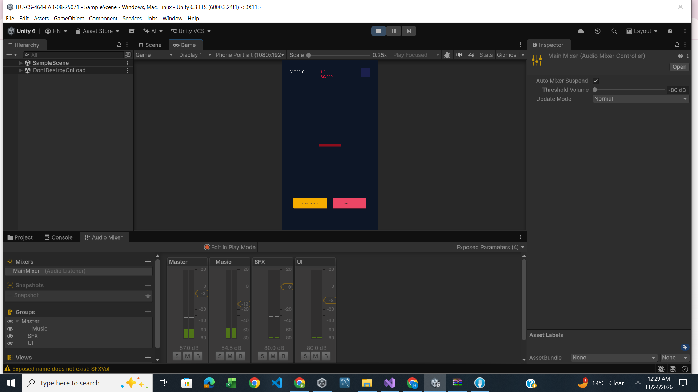

# Star Dash — Lab 08
**Roll Number:** BSCS25071  
**Course:** CS-464 Game Development (Lab 08)  
You can watch the complete walkthrough of the audio system, loading screen and event system here:  
[Watch the Lab 08 Demo](PASTE_YOUR_VIDEO_LINK_HERE)

## Project Overview
This project is an extension of our Star Dash game from Lab 07, developed using Unity 6. In this lab, we added an audio system, volume controls, a loading screen, and an event-based system to make the game more interactive and organized.
### 1. Audio System
- Created an `AudioMixer` with separate groups for **Master**, **Music**, **SFX**, and **UI** sounds.
- Implemented an `AudioManager` to manage background music and sound effects.
- Added music transitions between different scenes.
- Added volume controls for music, sound effects, and UI sounds.
- Saved volume settings using `PlayerPrefs` so they remain saved when the game is reopened.

### 2. UI Sounds
- Added sound effects for UI interactions.
- Implemented button click sounds.
- Added sounds for opening and closing panels, navigation, pause, and resume.
- Used a separate audio group for UI sounds.

### 3. Gameplay Audio
- Added sound effects for gameplay events, including damage, pickup, death, boost, win, and lose.
- Organized gameplay sound effects separately from UI sounds.

### 4. Loading Screen
- Created a loading screen using asynchronous scene loading.
- Added a loading progress bar and percentage display.
- Included gameplay tips during loading.

### 5. C# Events
- Implemented an event-based health system using C# events.
- Created listeners for different player events.
- Added functionality for health updates, damage sounds, screen flash, camera shake, and the game over screen.
- Used events to keep different systems separate and easier to manage.
| Settings Screen (Volume Sliders + Audio Mixer) | Audio Mixer Live (Master / Music / SFX / UI) |
| :---: | :---: |
|  |  |
- Settings screen has Music, SFX, UI and Master volume sliders plus the Vibration toggle.
- The Audio Mixer window shows the four groups reacting while the game is running.


- Async scene loading with a progress bar and percentage text.

- Main Menu from Lab 07 with button click sounds and music playing through the mixer.
| Health Event (HUD updates HP) | Game Over Event |
| :---: | :---: |
|  |  |

- When health changes, the event updates the HUD (`HP: 50/100`), plays the damage sound, flashes the screen and shakes the camera.
- When health reaches zero, the death event opens the Game Over screen.

- **Lab:** Lab 08
- **Project:** Star Dash

1. Clone this repository to your computer:
   ```bash
   git clone https://github.com/bscs25071-jpg/ITU-CS-464-LAB-08-25071.git
   ```
2. Open Unity Hub, click **Add → Add project from disk**, and select the cloned folder.
3. Open the project with Unity 6 (6000.3.24f1).
4. Open `SampleScene` (or the `Loading` scene) and press **Play**.
